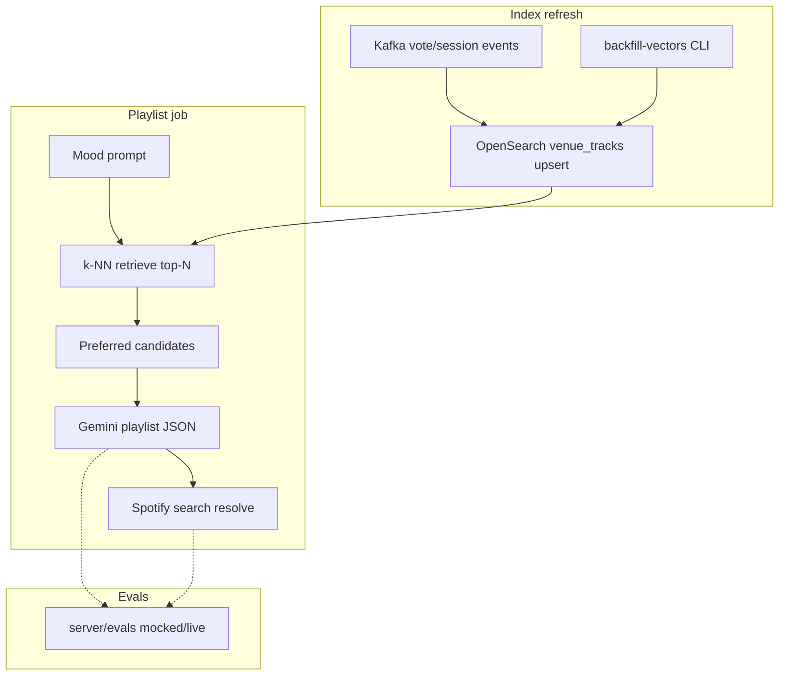
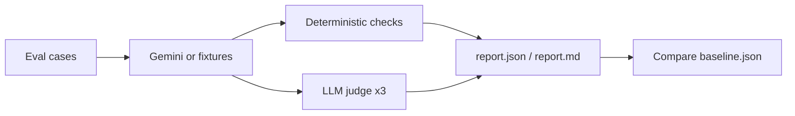

# Juke Spotify POC

[](https://github.com/hippi345/juke-spotify-poc/actions/workflows/ci.yml)
[](LICENSE)

A proof-of-concept **collaborative jukebox**: a Go API connects to Spotify, runs voting rounds on playlist tracks, refills playlists with AI-assisted suggestions (VibeSense / Gemini), and exposes a React web UI plus an optional Android patron client.

**Spotify use:** This project is for **personal, non-commercial demonstration only**. It is not licensed for commercial use, public performance, or shared venue playback beyond your own Spotify account terms. Do not deploy it as a product or multi-tenant service.

## Features

- **Spotify OAuth** — connect an account, pick a device, and control playback
- **Voting sessions** — guests vote on the next track from a curated candidate set
- **Playlist refill** — optional “similar vibe” track suggestions via Google Gemini
- **AI playlist jobs** — background jobs to build playlists from a text prompt
- **Web client** — React + Vite + Tailwind for the host UI
- **Email accounts** — staff (web host) and patrons (Android) register with email/password on the same API
- **Venue sessions** — staff set a venue location; sessions can be open or protected with a join password; patrons discover nearby active sessions and join before voting
- **Paid skip (demo)** — joined patrons pay **$1.00 USD** (Stripe **test mode**) to queue a playlist track next, ahead of the vote winner; only tracks already on the venue playlist are accepted
- **Android client** — Compose patron app: sign in, find nearby sessions, join, vote, paid skip (`mobile-client/`)

## Requirements

| Component | Version |
|-----------|---------|
| Go | 1.22+ (see `server/go.mod`) |
| Node.js | 22 LTS (see `client/.nvmrc`) |
| Docker | For local MySQL via Compose |
| Spotify app | [Developer Dashboard](https://developer.spotify.com/dashboard) credentials |
| Google AI (optional) | `GEMINI_API_KEY` for VibeSense / AI playlists |

## Quick start

### 1. Full stack (API + MySQL + web)

```bash
docker compose up -d --build
```

This starts the full production-shaped demo stack: **MySQL** (with scheduled dumps), **two Go API replicas** behind **nginx**, **Redis** (response and Spotify now-playing cache), **OpenSearch** (venue name search), **Kafka** (vote, payment, and session events only), **Prometheus** + **Grafana** (metrics), **Loki** + **Promtail** (container logs in Grafana), **Tempo** (distributed traces for votes and payments across the API and Kafka), and the **Vite** web client on **http://localhost:5173**. The API load balancer is **http://127.0.0.1:8081**; Grafana is **http://localhost:3000** (default login `admin` / `admin` unless you set `GRAFANA_ADMIN_PASSWORD`) with Prometheus, Loki, and Tempo datasources pre-provisioned. Compose loads **`docker-compose.env.example`** for placeholder env vars; copy it to **`docker-compose.env`** (gitignored) only when you want to override Spotify, Gemini, or Stripe settings locally.

**Spotify use:** Personal demo only — not for commercial use, shared venues, or multi-tenant deployment (see intro above).

MySQL only:

```bash
docker compose up -d mysql
# or: bash scripts/start-mysql.sh
```

### 2. API server

```bash
cd server
cp .env.example .env   # edit Spotify (and optional Gemini) values
go run .
```

Default API: **http://127.0.0.1:8081** (`PORT` overrides; avoid `8080` on Windows if another service uses it).

### 3. Web client

```bash
cd client
npm ci
npm run dev
```

Open **http://localhost:5173**. Copy `client/.env.example` to `client/.env` if the API is not at `http://127.0.0.1:8081`.

### 4. Android (optional)

See [mobile-client/README.md](mobile-client/README.md). Set `JUKE_API_BASE` in `gradle.properties` to your machine’s API URL (emulator default: `http://10.0.2.2:8081/`).

## Configuration

Secrets are **never** committed. Use environment variables or gitignored `.env` files.

### Server (`server/.env` or env)

| Variable | Default | Description |
|----------|---------|-------------|
| `DB_HOST` | `localhost` | MySQL host |
| `DB_PORT` | `3306` | MySQL port |
| `DB_USER` | `root` | MySQL user |
| `DB_PASSWORD` | `jukespotify` | MySQL password (local Docker only) |
| `DB_NAME` | `jukespotify` | Database name |
| `PORT` | `8081` | HTTP listen port |
| `SPOTIFY_CLIENT_ID` | — | Spotify app client ID |
| `SPOTIFY_CLIENT_SECRET` | — | Spotify app client secret |
| `SPOTIFY_REDIRECT_URI` | `http://127.0.0.1:5173/api/spotify/callback` | Must match Spotify app settings |
| `APP_BASE_URL` | `http://localhost:5173` | Post-auth redirect base |
| `GEMINI_API_KEY` | — | Google AI key for VibeSense / AI playlists |
| `GEMINI_MODEL` | `gemini-2.5-flash` | Optional model override |
| `VIBESENSE_VECTOR_ENABLED` | `false` | OpenSearch k-NN venue track grounding + similar search |
| `EMBED_PROVIDER` | `gemini` | `gemini` or `ollama` for venue track embeddings |
| `AUTH_SECRET` | — | HMAC secret for staff/patron login tokens (required for email auth) |
| `STRIPE_TEST_SECRET_KEY` | — | Stripe **test** secret key for paid-skip checkout (set in your environment only; never commit) |
| `STRIPE_WEBHOOK_SECRET` | — | Stripe webhook signing secret for `POST /api/stripe/webhook` (environment only) |

### Client

| Variable | Default | Description |
|----------|---------|-------------|
| `VITE_API_URL` | `http://127.0.0.1:8081` | API base URL |

## Usage

1. Configure Spotify redirect URI: `http://127.0.0.1:5173/api/spotify/callback`
2. Start MySQL, server, and client as above
3. Register a **staff** account, create a **venue** (location), **Connect Spotify**, choose a device and playlist, then start a voting session (optional join password)
4. On Android, register a **patron** account, search **nearby** sessions, **join**, then vote or use **paid skip** on a playlist track (requires Stripe test keys on the API)

### API highlights

- `GET /health` — liveness
- `GET /api/spotify/login` — start OAuth
- `GET /api/spotify/status` — connection state
- `POST /api/auth/register` / `POST /api/auth/login` — email accounts (`role`: `staff` or `patron`)
- `POST /api/venues` — staff creates a venue with lat/lng
- `GET /api/venues/nearby?lat=&lng=` — patron discovers active sessions
- `POST /api/venues/:id/join` — patron joins (optional `join_password`)
- `POST /api/voting/session/start` — begin voting (staff: include `venue_id`, optional `join_password`)
- `GET /api/voting/state` — poll session / round state
- `GET /api/paid-skip/config` — paid-skip price and whether Stripe is configured
- `POST /api/paid-skip/checkout` — patron starts Stripe Checkout for a playlist `track_id` (must have joined the session)
- `POST /api/stripe/webhook` — Stripe webhook (forward test events with the Stripe CLI)
- `POST /api/ai-playlist/create` — start AI playlist job (requires Gemini); optional `venue_id` when vector grounding is enabled
- `GET /api/venues/{id}/tracks/similar?q=…` — semantic “more like this” search over venue play history (vector flag)

## VibeSense architecture (vector + evals)



## Vector search

Optional **venue track** semantic search backs VibeSense grounding and the “more like this” API. It is **off by default**.

| Topic | Detail |
|-------|--------|
| **Index** | OpenSearch index `venue_tracks` (k-NN enabled) |
| **Documents** | `venue_id`, `spotify_id`, `title`, `artist`, `genres`, play/vote/queue counts, `last_seen`, `embedding` (`knn_vector`) |
| **Embedding model** | Default **Gemini** `text-embedding-004` via `net/http` (`GEMINI_API_KEY`). Optional **Ollama** `nomic-embed-text` when `EMBED_PROVIDER=ollama`. |
| **Embedding text** | `title — artist — genres` |
| **Storage** | OpenSearch **2.17** (Compose service); cosine HNSW on `embedding` |
| **Flag** | `VIBESENSE_VECTOR_ENABLED=false` by default. If OpenSearch/embeddings are missing, the API logs and falls back to non-vector VibeSense. |
| **Refresh** | Kafka consumers bump counts on vote/session activity; one-shot `go run ./cmd/backfill-vectors -venue-id=<id>` replays DB session history (best-effort). |
| **Privacy** | Vectors are derived from **track metadata already visible in the venue** (titles/artists/genres), scoped per `venue_id`. Embeddings are sent to Google (or local Ollama) only when the flag is on and a key is configured. No patron PII is indexed. |

## RAG (venue-history grounding)

When `VIBESENSE_VECTOR_ENABLED=true` and `venue_id` is supplied on `POST /api/ai-playlist/create`:

1. The mood **description is embedded** and used for k-NN search over that venue’s `venue_tracks`.
2. Top matches (count-boosted in the index) are passed to Gemini as **preferred candidates** in the prompt.
3. The prompt asks for roughly **50–70%** from those candidates and **30–50%** fresh picks.

**What this is:** retrieval-augmented **generation** in the narrow sense — retrieved track titles/artists are extra context for a single Gemini call. There is **no** multi-step agent, tool loop, or citation layer.

**What this is not:** full RAG over lyrics, audio, or the open web; no automatic verification that output tracks appeared in the index; refill/voting paths are unchanged unless vector ingest runs.

`TestVibeSenseVectorGate` in `server/evals` compares mocked runs with vector **on vs off** (fixture venue history). It must show lift in venue-history share without regressing judge scores, resolve rate, or latency — otherwise the vector PR should not merge.

## Development

### Qualitative testing and evals

VibeSense output quality is measured in `server/evals/` (Go, table-driven). Each case exercises the same shape as production: Gemini produces a JSON track list, then Spotify search resolves suggestions.



#### Deterministic checks (every case)

| Check | What it enforces |
|-------|------------------|
| JSON | Response parses to `[{title, artist}]` |
| Count | Returned tracks match requested count (after dedupe) |
| Duplicates | No duplicate normalized `title+artist` pairs |
| Spotify resolve rate | Share of suggestions whose top-5 Spotify hit matches title/artist (fuzzy) |
| Similar artists | When inspiration artists are set, share of suggestions by or related to them |
| Latency | Per-case timing; gate uses p50/p95 across the run |
| Error cases | Nonsense/empty prompts fail cleanly (no panic) |

#### LLM-as-judge

A **second** model scores each non-error case on **mood fit**, **crowd fit**, **variety**, and **coherence** (integers 1–5) with a one-sentence reason per dimension. Each case is judged **three times**; the report uses the mean (and spread is available in `report.json`).

| Setting | Default | Notes |
|---------|---------|--------|
| Provider | Gemini | Set `EVAL_JUDGE=gemini` (Ollama hook reserved for local experiments) |
| Model | `GEMINI_MODEL` or `gemini-2.5-flash` | Override with `EVAL_JUDGE_MODEL` |
| Temperature | **0** | Fixed in judge client for reproducibility |
| API key | `GEMINI_API_KEY` only | Never committed; live workflow uses GitHub secret |

#### Mocked vs live

| Mode | How to run | Keys |
|------|------------|------|
| **Mocked (default)** | `go test ./evals/` | None — recorded Gemini, Spotify, and judge fixtures in `server/evals/testdata/` |
| **CI subset** | `go test -short ./evals/ -run TestVibeSenseEvalGateCI` | Same fixtures; faster matrix |
| **Live** | `go test -tags evals_live ./evals/ -run TestVibeSenseEvalLive` | `JUKE_EVALS_LIVE=1` and `GEMINI_API_KEY`; optional Spotify for resolve checks. `-record` (live) refreshes fixtures when implemented |

```bash
cd server
go test -short -count=1 ./evals/ -run TestVibeSenseEvalGateCI
go test -count=1 ./evals/ -run TestVibeSenseEvalGate
JUKE_EVALS_LIVE=1 go test -tags evals_live -count=1 ./evals/ -run TestVibeSenseEvalLive -write-reports
```

#### CI workflows

| Workflow | Trigger | Purpose |
|----------|---------|---------|
| [vibesense-evals.yml](.github/workflows/vibesense-evals.yml) | Every PR / push to `main` | **Required gate:** mocked CI subset vs `baseline.json`; uploads `server/evals/out/` artifacts |
| [vibesense-evals-live.yml](.github/workflows/vibesense-evals-live.yml) | `workflow_dispatch` + weekly cron | Full live suite with `-tags evals_live`; skips cleanly if `GEMINI_API_KEY` secret is unset; job summary + artifacts |

**Branch protection:** mark **`VibeSense eval gate (mocked)`** as a required status check (workflow *VibeSense evals (mocked)*).

#### Baseline gate

After each run, metrics are compared to committed `server/evals/baseline.json` (`ci` and `full` sections). The gate **fails** if:

- Mean resolve rate drops more than **5 percentage points**
- Mean **mood fit** or **crowd fit** drops more than **0.2**
- JSON, count, or duplicate checks regress
- p50 latency rises more than **1 s**

Update baselines only deliberately:

```bash
go test -short ./evals/ -run TestVibeSenseEvalGateCI -update-baseline
go test ./evals/ -run TestVibeSenseEvalGate -update-baseline
```

Reports: `server/evals/out/report.json` and `report.md` (gitignored dir; CI uploads artifacts). Pass `-write-reports` or set `JUKE_EVALS_WRITE_REPORTS=1`.

### Tests

**Server** (SQLite in-memory; no Spotify or MySQL):

```bash
cd server
go test ./...
```

**Client**:

```bash
cd client
npm test
```

### CI

On push and pull requests to `main`, [`.github/workflows/ci.yml`](.github/workflows/ci.yml) runs:

| Job | What it does |
|-----|----------------|
| Go server | `go mod verify`, vet, golangci-lint, `go test -race` |
| [VibeSense eval gate (mocked)](.github/workflows/vibesense-evals.yml) | Separate workflow; `go test -short ./evals/` vs `baseline.json` |
| React client | `npm ci`, lint, test, production build |
| Android mobile client | `./gradlew testDebugUnitTest assembleDebug` in `mobile-client/` (JDK 21, Android SDK via Actions) |

### Lint

```bash
cd client && npm run lint
cd server && golangci-lint run   # install: https://golangci-lint.run/welcome/install/
```

### Stack check (all services running)

```bash
./verify-stack.sh
```

## Project structure

```
juke-spotify-poc/
├── client/              # React + Vite web UI
├── server/              # Go + Gin API (vendored deps in vendor/)
├── mobile-client/       # Kotlin / Jetpack Compose Android app
├── scripts/             # MySQL / Docker helpers
├── docker-compose.yml   # MySQL, API replicas, nginx, Redis, OpenSearch, Kafka, metrics, web
├── deploy/              # nginx, Prometheus, Grafana, MySQL backup scripts
├── .github/workflows/   # CI
└── SECURITY.md          # Vulnerability reporting
```

## License

[MIT](LICENSE) — Copyright (c) 2026 Joel Shearon
